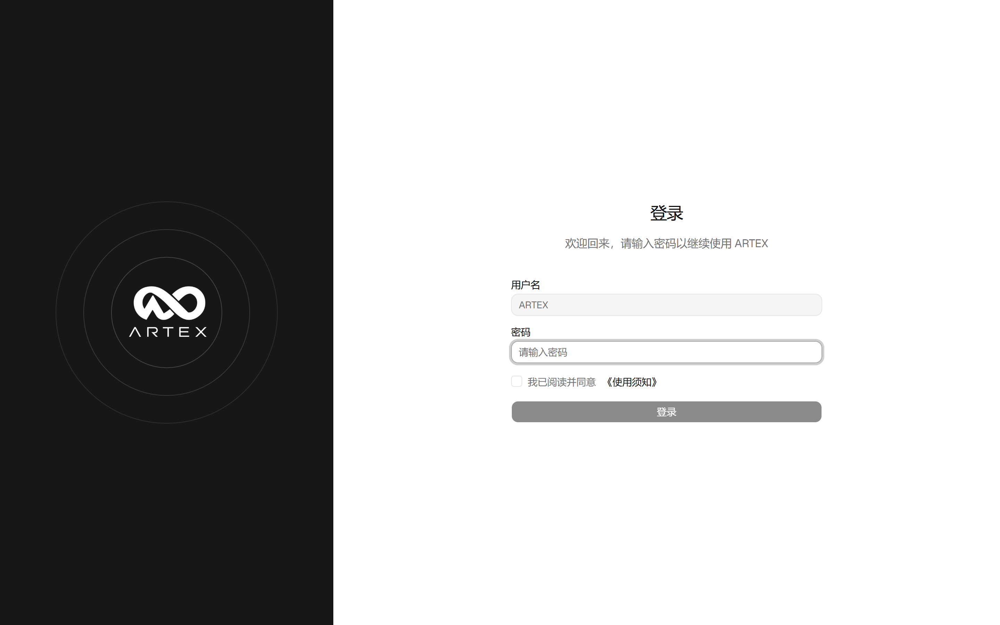
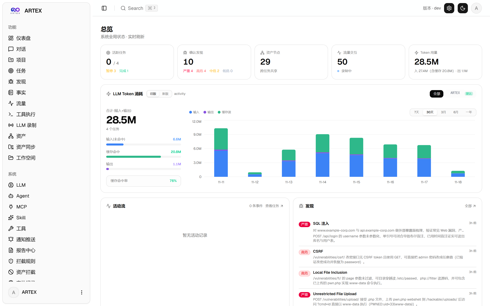
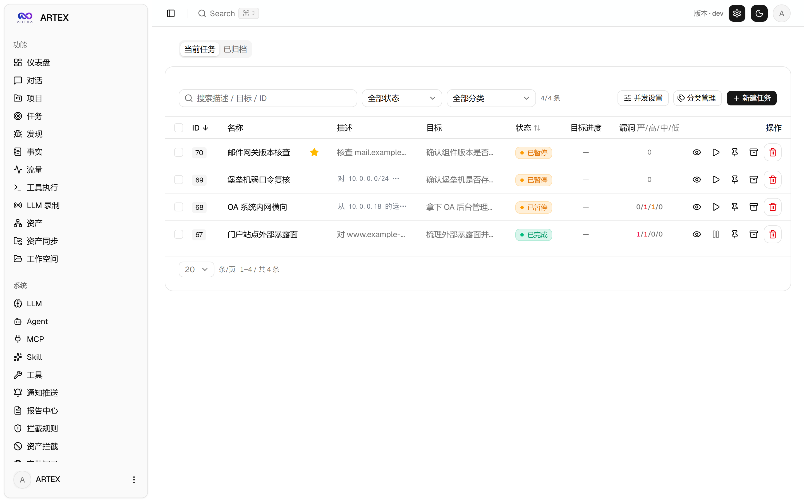
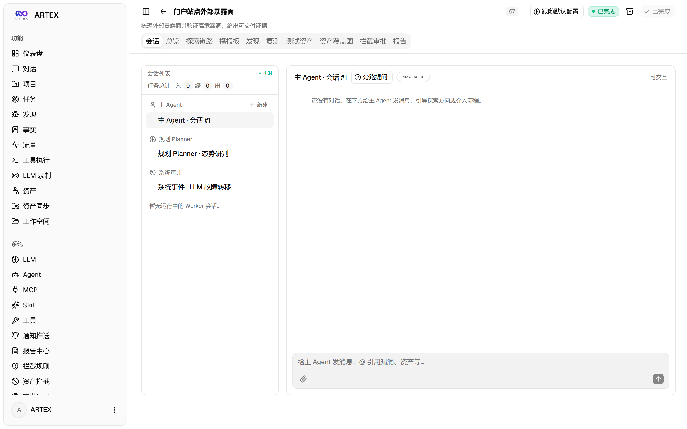
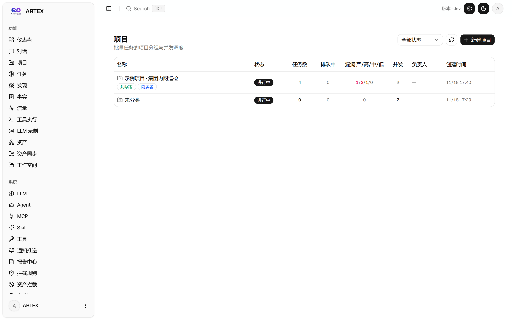
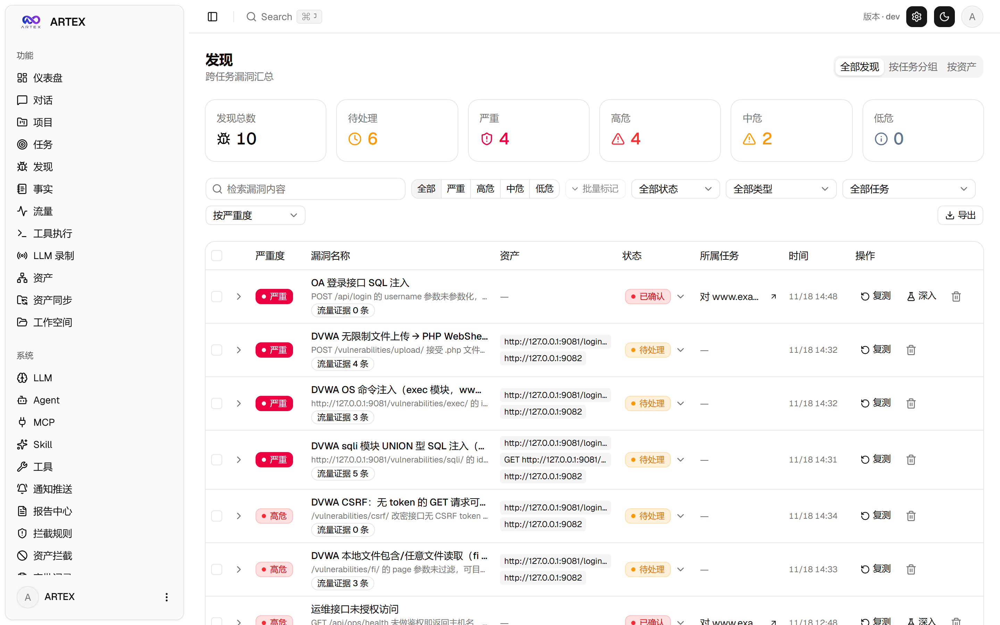
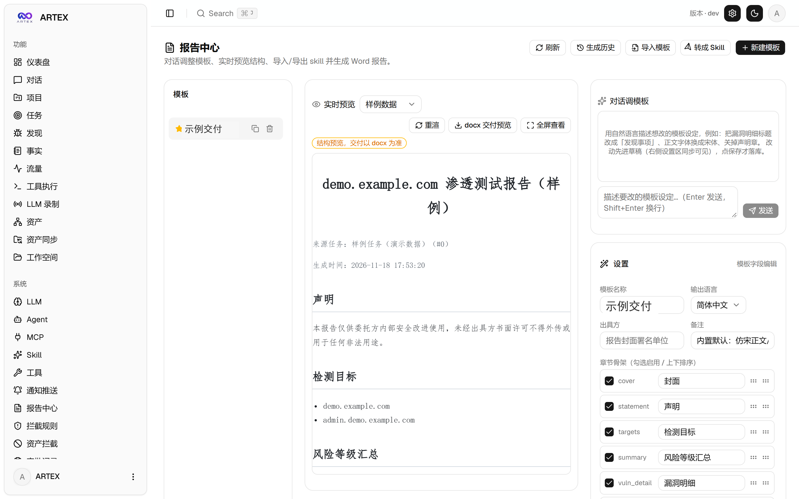
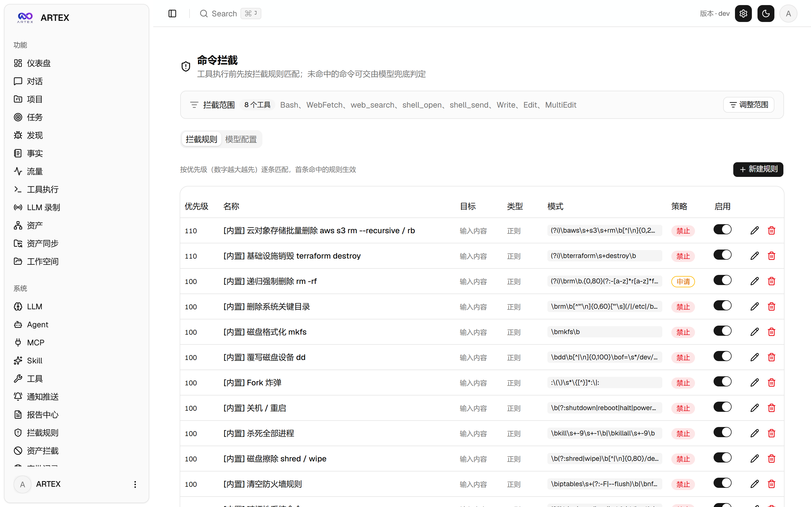
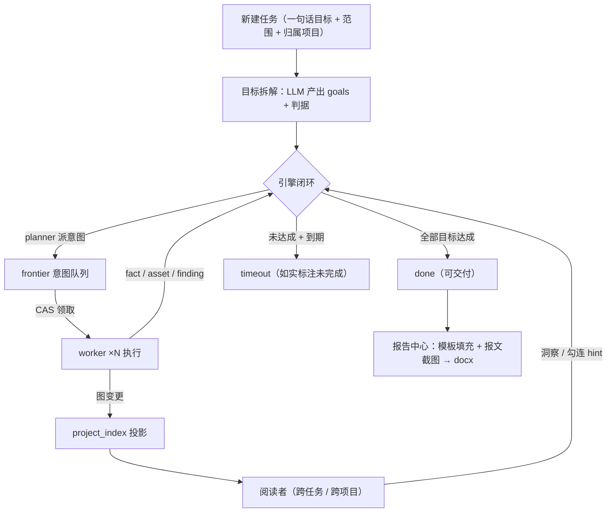

<div align="center">

# ARTEX-A

**AI 自主渗透测试平台 · 从一句话目标到能交付的 Word 报告**

> 目标拆解 → 侦察 → 漏洞验证 → 后渗透 → 证据留痕 → 报告交付，全程可回放。
> 二开重点不是"再加一个扫描器"，而是把**交付**这一段补完：模板化报告、报文截图、项目级批量下发与跨任务阅读者。

**Go 单体后端** · **Next.js 内嵌前端** · **PostgreSQL** · **多 Agent 自主推进** · **证据链留痕** · **Word 交付**

</div>

> **血缘声明**：本项目基于 [ARTEX](https://github.com/Autumn-27/ARTEX)（v0.3.15，AGPL-3.0）二次开发。
> 上游提供双图架构（资产图 + 探索图）、planner/worker 编排、MITM 流量代理与审批门框架；
> 本仓库在上游基线之上补齐项目维度调度、阅读者机制、报告中心与交付排版，差异逐条见
> [与上游 ARTEX 的差异](#与上游-artex-的差异) 与 [CHANGELOG.md](./CHANGELOG.md)。

---

## 快速开始

> 依赖 **PostgreSQL**；探索前需在 UI 里配置 **LLM**（Anthropic / OpenAI / 任意兼容网关，支持多通道轮询与故障转移）。

**方式一：一键安装脚本（推荐）**

```bash
git clone https://github.com/RongSec/ARTEX-A.git
cd ARTEX-A
./install.sh
```

脚本会检测 / 自动安装 Docker，然后让你选 **① 全部 Docker** 或 **② 本地编译运行**：

- **① 全部 Docker**：填 Postgres 密码（可回车随机）→ 自动写 `.env` → `docker compose up -d`。
- **② 本地运行**：选数据库（连已有 / 用 Docker 起一个）→ 生成 `config.json` → 编译内嵌前端单二进制 → 启动。

装好后打开 **http://localhost:8787**（首次进入 `/setup` 设置管理员密码）。

**方式二：Docker Compose**

```bash
cp .env.example .env      # 至少改 POSTGRES_PASSWORD
docker compose up -d      # → http://localhost:8787
```

镜像已含常用工具（ripgrep / curl / nmap / playwright 依赖等）；`./skills` 与 `./data` 绑定挂载持久化。

**方式三：预编译二进制**

到 Releases 下载对应平台 zip，解压得到 `artex` + `start.sh`（Windows 为 `start.bat`）+ `skills/`：

```bash
cp config.example.json config.json   # 填 database 连接
./start.sh                           # → http://localhost:8787
```

> 用 `start.sh` 启动而不是直接跑 `./artex`：它是守护脚本，页面上的「一键更新」靠它完成换装。
> 后台常驻：`nohup ./start.sh >artex.log 2>&1 &`。

**装好之后（3 分钟上手）**

1. 打开 `http://<host>:8787` → 初始化管理员密码（≥8 位；登录有防爆破锁定）
2. 「LLM」页配模型通道（≥2 个通道并开轮询 = 实战推荐），填 base_url + key + model 即可
3. 想试手感：新建项目 → 「批量下发」建几个任务 → 给一句话目标
4. 任务跑出漏洞后，「报告中心」上传自己的 docx 交付模板 → 生成报告直接落 Word

---

## 界面速览

> 截图取自真实运行实例，目标域名、IP、漏洞细节均为脱敏演示数据。

**登录与总览**

首次启动初始化管理员；登录失败按 IP 与全局双阈值锁定，失败响应固定 300ms 下限（抹平时序差）。




**任务执行**

任务列表：目标进度、漏洞分布、并发与排队状态一屏可见。
任务详情：主 Agent 会话 / 规划者态势 / 探索链路 / 黑板板 / 发现 / 复测 / 测试资产 / 资产覆盖图 / 拦截审批 / 报告。




**项目与批量下发**

项目是批量任务的调度单位：项目并发数决定同时在跑几个，排队中的任务按队首逐个认领；项目级「观察者 / 阅读者」两个开关分别管跨任务与跨项目的情报复用。



**发现与证据**

跨任务漏洞汇总：按严重度分档、按任务分组或按资产聚合；每条带流量证据、复测入口与报告状态。
新建任务未选项目时自动落入「未分类」，不再产生无归属的孤儿任务。



**报告中心**

左侧模板库、中间实时结构预览、右侧自然语言调模板与章节开关。上传的 docx 原样作为底稿：页眉页脚、logo、表格框线、字体规格全部保留，只填充锚点。



**命令拦截**

工具执行前先过规则匹配（按优先级、首条命中生效），未命中才交给模型判决。内置规则覆盖递归删除、磁盘格式化、DROP / TRUNCATE、FLUSHALL、云存储批量删除、数据外泄管道等。



---

## 核心能力

### 1. 多 Agent 自主推进

- **主 Agent** 接人类指令、拆目标、派意图；**planner** 每轮读探索图决定下一批意图；**worker ×N** 并发执行工具调用。
- 目标必须带可核验的完成判据：`prove_goal` 未达成不会假装收尾，任务落 `timeout` 时如实标注"未完成"。
- 发现 critical/high 后可以派发继任意图（确认 → 利用 → 影响验证），而不是"扫出来就算完"。

### 2. 项目-任务两级调度

- 项目 → 任务两级模型，`tasks.project_id` 可空但新建任务不再允许空：不选就进「未分类」项目。
- 项目 `concurrency` 管项目内并发；批量下发写入 `queue_mode='project_batch'`，由 dispatcher 按队首原子认领，不会因全局 reconcile 而越过项目额度。
- 项目归档 / 删除支持"保留任务（转为未分组）"与"连带删任务"两种语义。

### 3. 阅读者：跨任务观察 + 跨项目串联

- 图变更即触发（`on_project_graph`），另加 30 分钟定时兜底；一波图变更合并成一次会话，不会一次变更烧一轮 token。
- **跨任务阅读者**（scope=project）：读项目投影 `project_index`，按 task_id 下钻被勾连任务的探索图摘要，判定"同一攻击面 / 同一资产 / 同一利用链"后用 `adopt_related_task` 把结论以结构化 hint 暴露给发起方 planner；不相关则 `dismiss_related_task` 留痕。
- **跨项目阅读者**（scope=cross）：先看 `cross_project_assets`（同一资产出现在 ≥2 个项目的 join 结果），为空直接空转，非空才写 `global_insights`。
- 只读红线：阅读者 `tool_base='none'`，没有任何执行类工具，不调扫描、不发请求。

### 4. 关联任务只读继承

- 新建任务可关联最多 **8** 个来源任务，实时只读继承其持久化黑板（目标 / 提示 / 事实 / 发现 / 意图）、资产范围与运行轨迹；新任务写入自己的黑板，继承的节点带 `source_task_id` 与 `inherited=true`，`record_fact` 会拒绝对继承意图写回。
- 只继承一层（来源任务的来源任务不递归），并按来源数分配文本预算，超出部分仍可经读工具按需取。

### 5. 报告中心：模板填充 + 报文截图

- **模板即底稿**：上传的 docx 被作为骨架，用 deepcopy 原 XML 节点的方式填充，页眉页脚 / logo / 表格框线 / 字体规格不动；无模板时回退到内置排版器。
- **报文截图**：每个漏洞证明步骤自动渲染"左请求 / 右响应"深色报文图（方法、状态码徽标、头名蓝值灰、JSON/HTML 语法高亮、软断点换行），一张图对应一个步骤，图注全报告连续编号「图N」。
- **命名规则**：默认 `{system}渗透测试报告-{YYYY-MM-DD}`，支持 `{system}{title}{task}{project}{date:...}` 等占位符。
- 另有「报告归档」视图与项目级自动报告（项目收官出一份 / 子任务各出一份，两个开关独立）。

### 6. 三层安全红线

| 层 | 机制 | 作用 |
| --- | --- | --- |
| 命令拦截 | 规则匹配 + 模型研判 → allow/ask/deny | 破坏性命令、删除类接口、数据外泄管道 |
| 短路规则 | 平台自身路径 / 凭据裸读 / 控制面接口直接短路 | agent 不能读平台密钥、不能打自己的管理接口 |
| 资产拦截 | 任务级 + 全局资产范围硬拦截 | 范围外目标一律拒打，越界写回在数据层被拦 |

审批记录全量留痕（含命中规则、模型理由、输入摘要），可回放"这个结论是怎么被允许/拒绝的"。

### 7. 资产图与流量证据

- 资产台账按企业 → 根域 / IP / 子域 / 服务 / 接口分层，支持 ScopeSentry 直接同步。
- MITM 代理逐请求留存流量，发现可绑定具体请求作为证据，报告引用同一份证据版本。
- 资产覆盖图力导向布局，已测节点高亮，用于回答"还有哪里没打"。

---

## 系统架构



```
cmd/            程序入口（artex 主服务）
agent/          多 Agent 层：planner / worker / mainagent / 工具集
db/             PostgreSQL 唯一存储：schema.sql 幂等迁移 + 各表 Store
server/         HTTP 路由 / 引擎调度 / Manager / 项目 / 阅读者 / 报告
intercept/      拦截引擎：规则匹配 → 模型研判 → allow/ask/deny
guard/          工具调用审批门（裁决接进执行链）
traffic/        MITM 流量记录代理 + 出口代理池
report/         报告生成：模板填充器 / 报文截图 / Word 导出
skills/         内置 skill（方法论按需加载）
web/            Next.js 前端（静态导出后 go:embed 内嵌）
```

### 一次任务的完整生命周期

1. 建任务：写 `explorations` + `tasks`（同事务），落归属项目、来源任务、LLM 链、任务级拦截规则
2. 目标拆解：LLM 产出 goals 与判据，落探索图
3. 规划-执行闭环：planner 读图派意图 → worker 领意图执行 → 写回事实 / 资产 / 漏洞
4. 图变更：投影到 `project_index` → 阅读者判定勾连 / 写洞察 → 必要时给 planner 下 hint
5. 收官：目标全达成落 `done`，到期未达成落 `timeout`；终态钩子触发项目自动报告
6. 交付：报告中心按模板填充 docx，漏洞证明里带报文截图与截图证据

---

## 与上游 ARTEX 的差异

| 维度 | 上游 v0.3.15 | 本仓库 |
| --- | --- | --- |
| 任务组织 | 单任务平铺 | 项目-任务两级 + 项目内并发闸门 + 批量下发 |
| 跨任务情报 | 无 | 阅读者：图变更触发 + 项目投影 + 结构化勾连 |
| 任务继承 | 可关联来源任务（只读继承） | 保留，并限制一层继承、分配文本预算、拒写继承意图 |
| 报告 | 内置排版器生成 docx | 以用户 docx 为底稿填充，保留页眉页脚与表格框线 |
| 证据 | 截图人工上传 | 报文自动渲染"左请求右响应"并逐步骤插入，图注连续编号 |
| 报告管理 | 单文件下载 | 报告中心（模板库 / 实时预览 / 对话调模板 / 归档 / 命名规则） |
| 拦截 | 命令拦截 | 命令拦截 + 短路规则 + 资产拦截三层，合并为三个页签 |
| 登录安全 | 密码 + JWT | 追加防爆破（IP/全局双阈值）、改密轮换签名 key、query token 收窄到 SSE |
| 交互 | 单页工具型 | 任务页合并小结、项目页归档/删除、删除选项与任务同构 |

---

## 部署与运维

**默认端口**：HTTP `8787`，流量代理 `8788`（`-addr` / `-proxy` 可改）。

**数据**：Postgres 数据卷 `pgdata` + `./data`（`jwt.key`、任务工作区、transcripts、报告、证据）+ `./skills`。升级不动数据；`schema.sql` 每次启动幂等重跑（重启即迁移）。

**备份建议**：`pg_dump` 每日一次 + `./data` 目录同步。任务工作区与报告都在 `./data` 下，只备份数据库会留下无法对应文件的黑洞（本项目线上曾因只清库不清盘留下 41 个无主工作区目录）。

**更新**：

- 页面一键更新：系统配置 → 版本与更新。下载 → 校验 SHA256 → `-h` 冒烟 → 暂存 `artex.new` → 由 `start.sh` 换装；连续 3 次启动失败自动回滚 `artex.old`。
- 脚本更新：`./update.sh`（Docker / 本地编译两条路径）。
- 更新会中断正在运行的任务，请在空闲时进行。

**远程 MCP**：系统设置里可选 `http`（Streamable HTTP）或 `sse`（旧版 SSE）。旧版 SSE 服务通常 `GET /sse` 建流，再用返回的 `/message?sessionId=...` 收 JSON-RPC；URL 填 `/sse`，请求头按 `Authorization=Bearer <token>` 填。

---

## 开发

```bash
./dev.sh                                          # 后端 :8787 + 流量代理 :8788 + 前端 next dev :5173
go test ./...                                     # 连 PG 跑全量
cd web && npx tsc --noEmit && npm run build       # 前端类型检查 + 静态导出

# 单二进制（前端静态导出 + go:embed 内嵌）
cd web && NEXT_EXPORT=1 npm run build && cd ..
CGO_ENABLED=0 go build -tags embedui -o artex ./cmd/artex
```

- 后端：`go run ./cmd/artex`（`-tags embedui` 才内嵌前端）
- 前端：`cd web && npm run dev`（`/api` 反代热更新）
- Mock 预览：`cd web && NEXT_PUBLIC_MOCK=1 npm run dev`

工程细节（Go / Node 版本、模块代理、release 打包）见 [README.artex-hs.md](./README.artex-hs.md)。

---

## 实战纪律与安全边界

- **授权优先**：任务创建即声明范围（域名 / IP / 企业主体），范围外目标在拦截层被拒，不靠自觉。
- **最小伤害验证**：SQL 注入默认只读探测；文件上传只验证能力不落地后门；登录面默认口令尝试有上限，成功即停。
- **破坏性操作审批**：删除类接口、磁盘操作、数据外泄管道走 deny/ask 闸门，裁决与理由全量留痕。
- **复测纯手动**：平台不自动触发任何复测动作。
- **凭据卫生**：LLM key、测绘 key 只进运行时配置，不入仓库、不入报告；agent 读不到平台自己的 `jwt.key` 与控制面接口。

---

## 许可与免责声明

**AGPL-3.0**：衍生作品（含网络服务）须同样开源。完整条款见 [LICENSE](./LICENSE)。

本项目仅供**已获得书面授权**的安全测试、红队演练与教学研究使用。使用者须自行确保测试目标在授权范围内，并对使用行为及后果负责。作者不对任何未授权使用、数据损坏或法律后果承担责任。

上游 [ARTEX](https://github.com/Autumn-27/ARTEX) 版权归原作者所有；本仓库的二开部分同样以 AGPL-3.0 发布。
